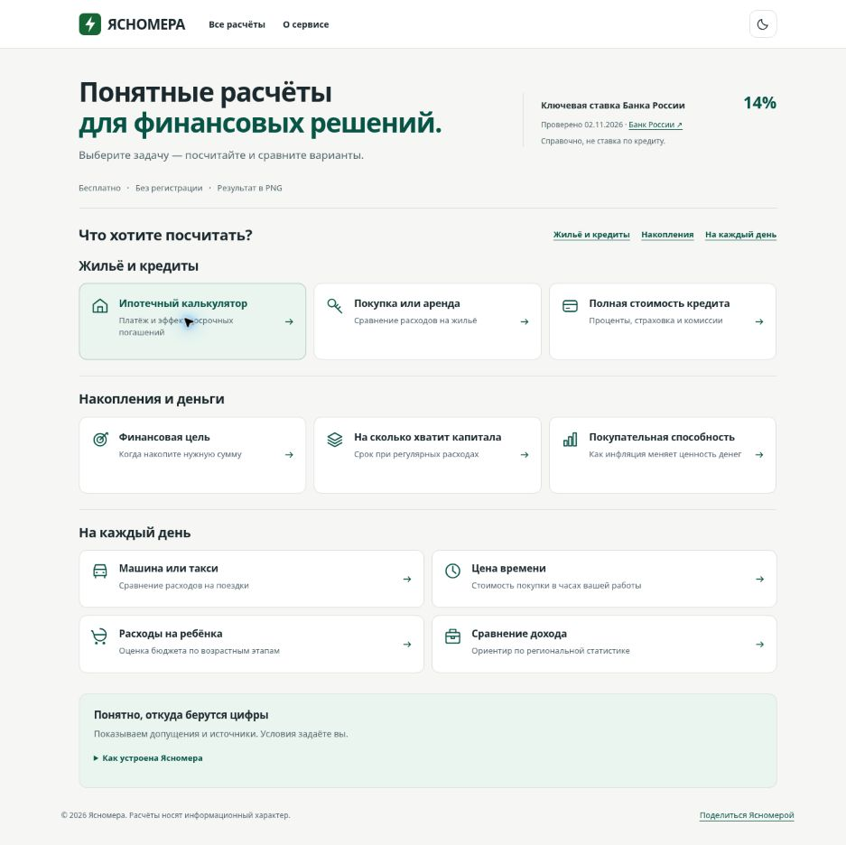

# Главная: вариант A — 02.11.2026

**Актуальное дополнение:** после founder review согласованный финальный проход выполнен в том же PR #94. [Полировка, новые размеры и снимки](polish/README.md). Этот исходный отчёт и его captures сохранены как baseline до полировки.

Реализация в ветке `codex/homepage-navigator`, база main `48c3579` после merged #93. Главная ещё не main/production. Математика, HTML калькуляторов, общие JS/CSS, JSON, SW и 35-файловый deploy allowlist не менялись.

## Результат

Статический каталог 3+3+4: все десять прямых ссылок с описаниями доступны без рендера JavaScript. Три якоря прокручивают к разделам и не фильтруют остальные. Заголовок/описания не обещают выгоду. Mobile-верх компактнее концепта; на самых узких экранах подписи якорей переносятся внутри одного 44px ряда. Light/graphite, нативные ссылки/details/dialog, focus и reduced motion.

Число ставки — из rates.json через уже существующий API helper. Показываются успешная дата проверки и официальный источник. 72ч soft / 7дней hard TTL совпадают с publish policy; stale помечен явно, unavailable/HTTP/формат/срок/источник не выдают число. Есть 8-секундный timeout. Нет hardcoded 14% или выдуманного «сегодня».

## Проверки

- `npm test`: **156/156**, 0 failures/skips. Новые шесть тестов покрывают rate value/date/zero, stale/expired/status disagreement, диапазон/формат/официальный источник/даты, границы TTL, десять уникальных ссылок с описаниями и существующими destination-файлами.
- `npm run validate:data`: rates/inflation/regions publish gates успешно.
- `git diff --check`: успешно.
- Workflow path-filter дополнен index.html; gates не ослаблены.

Целевой Chrome QA через CUA; в отдельной QA-копии Метрика заменена stub, в repo counter 110360838 сохранён.

| Проверка | Результат |
|---|---|
| Desktop light / graphite | Композиция, все десять назначений/описаний, контраст и состояния темы просмотрены |
| Responsive iframe 390 / 360 / 320 | Реальные client widths 375 / 345 / 305 с классическим scrollbar; scrollWidth=clientWidth. Физическим устройством это не является |
| Mobile theme | Светлый и графитовый варианты просмотрены; тема сохраняется между страницами/перезагрузками |
| Якорь «На каждый день» | Прокрутка, все четыре описания видны, другие карточки не исчезают |
| Enter на «Как устроена Ясномера» | Раскрываются источник/модель/пояснения о вводе и Метрике |
| Переход в ипотеку → back | Открывается прежняя ипотека с результатом 111 300 ₽ и сравнением 26,71 млн; возврат в каталог работает |
| Свежая ставка | 14%, реальная дата 02.11.2026 из текущего snapshot |
| Stale / upstream unavailable / malformed / expired / HTTP 404 | Stale с явной подписью; остальные без числа. Все десять переходов доступны |
| Share / clipboard blocked | В локальном HTTP-контексте clipboard недоступен: открывается dialog с правильным URL, выделением, закрытием и восстановлением фокуса. Отдельный forced-failure QA вариант тоже проверен |

Не проверены физический Samsung/iOS, native Android share и успешная clipboard-запись в production HTTPS. Полный прежний mortgage browser runner и повторная engine matrix не запускались: эти runtime-файлы не менялись. Переход в ипотеку был smoke, не новый аудит. Offline не подтверждён: остаётся прежний SW/CDN-контракт остальных страниц.

Preview live-reload сбрасывал открытый dialog после изменения QA-копии; состояние прочитано заново. Full-page/clip screenshot API возвращал timeout; сохранены реально полученные обычные browser captures, без дорисовки.

## Снимки реализации

[Desktop light](desktop-light.jpg) · [Desktop graphite](desktop-dark.jpg) · [Mobile light](mobile-light.jpg) · [Mobile graphite](mobile-dark.jpg). Это реальные browser captures, не imagegen reference.

## Аналитика

Счётчик и share_click сохранены. Исходный пример/навигация не создают calculate_success; mortgage-контракт не менялся. Прежние goal_category_* относились к удалённым фильтрам; новые якоря/переходы записываются как categorical `params.home_catalog.action/target`, не переиспользуют старые цели с новым смыслом. Не сравнивать старые category-goal counts с новыми якорями. Главная не используется посадочной страницей ипотечного рекламного теста.

## Приёмка

Один просмотр на Samsung: обе темы, все разделы, переход в ипотеку и назад, источник ставки, «Поделиться». Затем согласованный merge/штатный deploy. Реклама не запускалась; кабинет Direct не открывался, настройки/траты не менялись.
