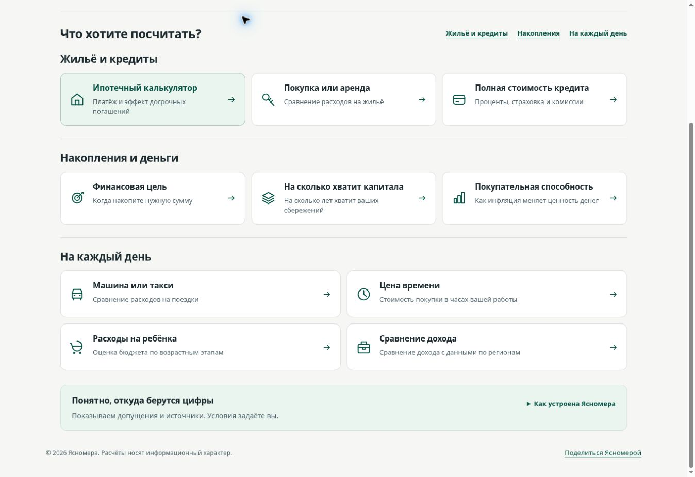

# Завершающая полировка главной A

02.11.2026, тот же PR #94, поверх head 6382e83. Основатель одобрил все четыре пункта review: плотность больших карточек, компактный trust-блок, конкретное вступление/понятная подпись сохранения, два описания. Чёрные плавающие кнопки на founder screenshot исключены из scope по его прямому указанию. Merge/deploy/реклама не выполнялись.

## Реализация

- Desktop min-height больших карточек 122 → 102px, внутренний отступ 18px. Заголовки выровнены по началу текстового блока; размер текста и все десять переходов/описаний сохранены. На планшете до 1000px — две колонки вместо тесных трёх. Mobile остаётся одной колонкой.
- Закрытый trust-блок: заголовок/пояснение слева и native summary справа. При раскрытии текст занимает всю ширину. На mobile summary возвращается в normal flow под пояснение; native details/Enter/44px target сохранены.
- Подзаголовок: «Посчитайте платёж, срок накоплений и повседневные расходы». Возможность PNG объяснена «Расчёт можно сохранить», сама функция не менялась. Уточнены описания капитала/дохода.
- Все script tags index.html побайтно совпадают с 6382e83. Справка о ставке/данные/analytics/share и калькуляторы не изменены.

## Проверка

`npm test`: 156/156, 0 failures/skips. Новые тесты для косметики не добавлялись. `git diff --check` успешно.

Сравнение при одной desktop client width **1348px**:

| Блок | До | После |
|---|---:|---:|
| Первая карточка | 122px | ≈103,5px |
| Закрытая справка о сервисе | ≈149,8px | ≈89,8px |
| Высота страницы | 1346px | 1244px |

Это измерение одного браузерного viewport, не универсальная гарантия высоты на устройствах.

Целевой CUA/Chrome QA: desktop обе темы; mobile 390 (client 375), 360 (345), 320 (305), tablet 800 (785). Во всех проверенных размерах scrollWidth=clientWidth, 10 ссылок сохраняются. На tablet проверена читаемая двухколоночная раскладка; CTA не перекрывает заголовок. Mobile описание/возможности переносятся без обрезания. Native details открывается/закрывается Enter и кликом, mobile summary имеет 44px height, раскрытые пояснения не накладываются.

Preview DOMSnapshot/screenshot API несколько раз дали timeout. Открыта свежая вкладка того же браузера, повторные проверки завершены через документированный getScreenshot. Снимки — реально сохранённые bytes, без дорисовки.

Физический Samsung/iOS и production не проверялись; прежние ограничения native share/HTTPS clipboard/offline сохраняются. Повторный mortgage audit/engine matrix не выполнялись — его файлы не изменены.

[Верх desktop](desktop-light.jpg) · [Каталог и trust-полоса](catalogue.jpg) · [Mobile graphite](mobile-dark.jpg).

Проход по согласованному scope завершён. После одной приёмки — merge #94 и штатный deploy/smoke; новых визуальных концепций не требуется.
