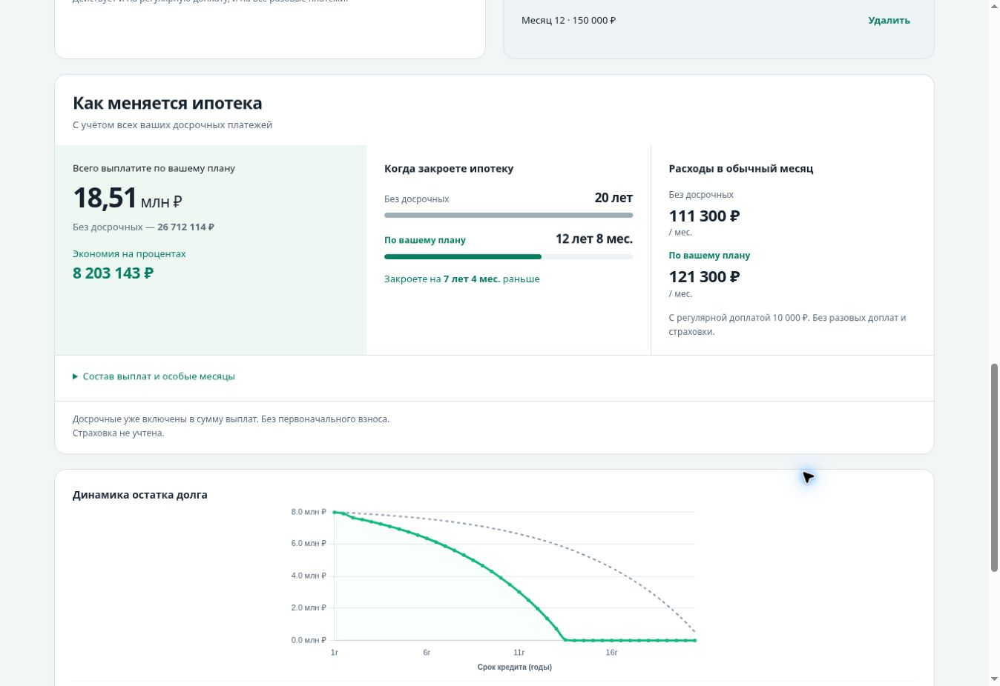
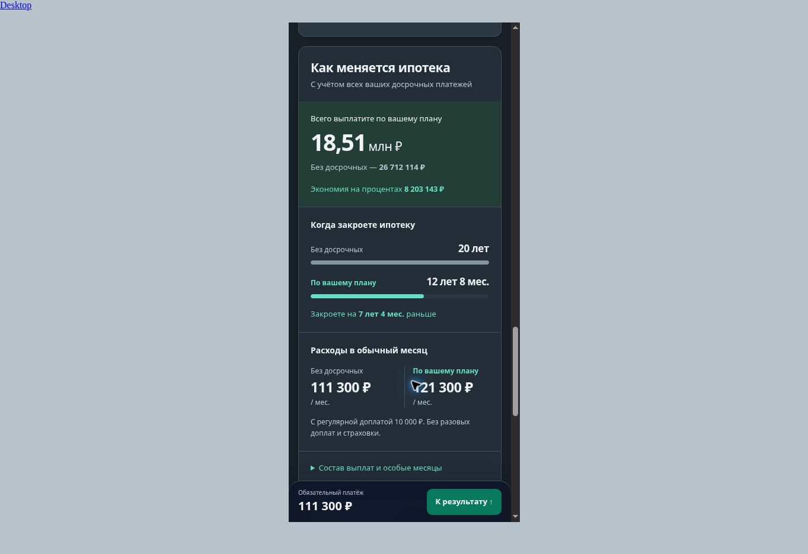

# Единая карточка «Как меняется ипотека» — 02.11.2026

Реализована в существующем PR #92 поверх 85dc961. Не merged, не опубликована. Изменены live presentation в mortgage.html, regression assertions и канонические документы. Модель, общие JS, данные, exporter и share codec не менялись.

## Проверка

- `npm test`: **143 passed**, 0 failed/skipped (до изменения 140).
- `node dev_tools/compare-mortgage-engine.cjs`: **66 сценариев идентичны** baseline fd292a7, включая каждую строку графика.
- `npm run validate:data`: rates / inflation / regions — schema + semantic + freshness OK.
- `git diff --check`: без ошибок.

Целевая ручная автоматизация через CUA/Chrome по временной QA-копии текущего runtime. Только в QA-копии Метрика заменена no-op, чтобы не отправлять тестовые конверсии. В PR код счётчика неизменён. Desktop viewport 1363×936; mobile iframe шириной 390 и 360 px с классическим scrollbar (доступная CSS-ширина 375 / 345 px).

| Проверка интерфейса | Результат |
| --- | --- |
| Нет доплат | Один исходный план, без фиктивной нулевой экономии и повторных сроков |
| Только регулярная 10 000 ₽ | 19 368 872 ₽, 13 лет 4 мес.; одна карточка |
| Только разовая 150 000 ₽ в мес. 12 | 24 228 054 ₽, 18 лет 1 мес.; одна карточка |
| Обе доплаты | 18 508 971 ₽ против 26 712 114 ₽; экономия 8 203 143 ₽; 12 лет 8 мес. вместо 20 лет |
| Месячная нагрузка и разовый месяц | 111 300 / 121 300 ₽ в обычный месяц; в раскрытии мес. 12 — 271 300 ₽ |
| Уменьшать платёж | Явно «Нагрузка в первый месяц» и последующие изменения; в проверенном примере срок 20 лет, без ложного обещания сокращения |
| Страховка | Итог включает страховку; сводная экономия «Меньше выплат на»; месячная нагрузка без страховки |
| Действующая ипотека | Текущий остаток и только будущие выплаты, прошлые не суммируются с будущими |
| Невалидная цена → исправление | Карточка скрыта/очищена, затем восстановлена; export guard дополнительно покрыт unit tests |
| Desktop / мобильные ширины | Отдельные формы, одна карточка после обеих, нет наложений и горизонтального переполнения карточки |
| Light / graphite | Проверены через UI; сохранены реальные снимки ниже |
| Share | Скопирован URL, открыт заново; обе доплаты и итог 18 508 971 ₽ восстановлены |
| PNG | Реальный download 1200×2058, читаемые условия/итог/срок и чистый график; сохранён ниже |

Новые unit assertions дополнительно проверяют страховую экономию, первую нагрузку при снижении платежа и ограничение регулярной доплаты оставшимся долгом при мгновенном закрытии.

## Реальные снимки

[Desktop light](comparison-desktop-light.jpg) · [Desktop graphite](comparison-desktop-dark.jpg) · [Mobile graphite, верхняя часть карточки](comparison-mobile-dark.jpg) · [Реально скачанный PNG](combined-export.png).

## Ограничения и следующий шаг

Полный прежний runner на 51 browser check не перезапускался; приведённые выше проверки выполнены адресно через интерфейс. Mobile iframe — проверка responsive layout, не физическое Android/iOS или настоящая экранная клавиатура. Попытка full-page скриншота 360px iframe завершилась timeout; размеры DOM и отсутствие overflow проверены, отдельный full-page снимок не заявляется.

На реальном Samsung проверить понятность/читаемость единого сравнения, смену стратегии и раскрытие; прежняя короткая приёмка Back-with-retained-focus, safe-area и download-after-chart-touch остаётся из fixes-2026-11-01. После приёмки — отдельное решение владельца о merge/выпуске, production smoke/Метрика, затем рекламный тест. Production и Direct этой задачей не менялись.
