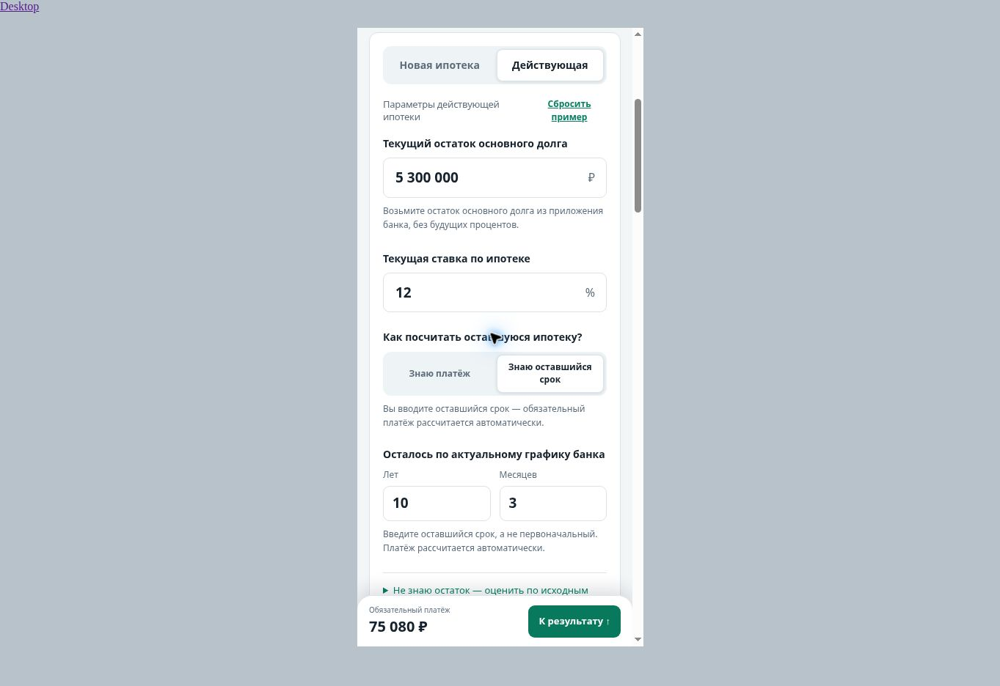

# Действующая ипотека: утверждённая форма — 02.11.2026

Продолжение PR #93 поверх a68e16e. Схема одобрена основателем после production QA. Реализация только в PR, ещё не main/production. Метрика: основатель сообщил, что после обновления отчёта его контрольные calculate_success появились; прежнее отсутствие на графике не объявляется доказанной потерей события.

## Что реализовано

- Основные поля — текущий банковский остаток, текущая ставка, выбор «Знаю платёж / Знаю оставшийся срок». По умолчанию платёж. В обоих режимах сохраняются банковские вводные, ставка, оба вида доплат и страховка.
- Введённый оставшийся срок хранится независимо. В основной форме нет исходной суммы/прошедших месяцев. Месяцы 0–11, суммарно 1–600; невалидные данные закрывают результат/экспорт до восстановления.
- Необязательное раскрытие оценки имеет независимый draft: редактирование/ошибка не меняют текущий финансовый сценарий и не создают calculate_success. Явная подстановка переносит только оценённый остаток/срок и метаданные исходного графика; текущие ставка/платёж/доплаты сохраняются.
- История целиком рассчитана по единому исходному аннуитетному графику, отдельно от ручного текущего остатка. Никакого «реального прогресса»/пустой большой карточки. Нужные допущения и ограничения видны.
- Ссылка сохраняет режим, явный remaining duration, оба вида доплат, страховку, происхождение остатка и применённые исходные условия. Старые ссылки без нового duration используют исходный term−paid, сохраняя прежние числа и строгую валидацию. Не применённый draft в финансовую ссылку не попадает.
- PNG содержит только будущие выплаты и компактно указывает режим/происхождение остатка. История не суммируется с будущими. Изолированный чистый export Chart сохранён. Ползунок остатка синхронизирован с полем и восстановленной ссылкой; новые суммы не заменяются скрытой моделью.

## Автоматическая проверка

**150/150 npm tests**, 0 failures/skips. **66 engine scenarios идентичны** production baseline fd292a7, включая все строки. Все datasets проходят publish validation. `git diff --check` без ошибок.

Новые regression cases проверяют сохранение банка/доплат при смене режимов/ставки, независимую длительность и границы, изоляцию draft/экспорта/цели, явную подстановку, согласованную историю, нулевую ставку/погашенный исходный график, старые и новые share URL, provenance и синхронизацию range.

В simulator расширен только выбор входного срока: optional activeRemainingMonths ?? legacy originalTerm*12−paid. Формулы, округления, страховка, обе стратегии, график и 600-месячный предел прежние. Новый параметр по умолчанию null для legacy fixtures/ссылок.

## Целевая проверка в Chrome через CUA

Временная QA-копия runtime, только там Метрика заменена no-op. Desktop и iframe 390 / 360px (CSS-ширина с классическим scrollbar 375 / 345px), light/graphite. Это responsive QA, не физические Samsung/iOS.

| Сценарий | Наблюдение |
| --- | --- |
| Банковский остаток 5 300 000, ставка 12%, платёж 85 000 | Остаток сохраняется, срок 8 лет 3 мес.; исходные условия скрыты |
| Переключение на срок 10 лет 3 мес. и назад | Расчётный платёж 75 080; назад возвращается введённый платёж 85 000, остаток тот же |
| Space на сегменте | Выбор режима работает с клавиатуры |
| Месяцы 12 → 3 | Ошибка скрывает финансовый результат; корректировка восстанавливает |
| Изменение optional draft, затем неверная исходная ставка | Банковский остаток/план сохраняются, кнопка применения блокируется |
| Исходные 8 млн, 12%, 20 лет, внесено 4 платежа | Оценка остатка 7 967 164; история: тело 32 836 + проценты 319 512 = всего 352 348 ₽ |
| Явная подстановка оценки | Remaining 19 лет 8 мес.; ставка, платёж, регулярная и разовая доплаты сохраняются; источник отмечен как оценка |
| Оценённый остаток не покрывается прежним платежом | Честная ошибка основного расчёта; исправление платежа восстанавливает. Валидная optional история остаётся доступной независимо |
| Share банковского и оценённого сценариев | Оба восстановлены; у оценённого также страховка/две доплаты/стратегия уменьшения платежа/remaining 236 |
| Старая ссылка без новых параметров | 5 300 000, 12%, исходные 20 лет−36 мес.: оставшиеся 17 лет, платёж 61 014 ₽ |
| Narrow 360, раскрыта оценка и история | Нет горизонтального переполнения; при ошибке основного остатка история остаётся отдельной валидной оценкой |
| PNG двух режимов | Реальные downloads, читаемый режим/источник/будущие суммы, чистый график. Снимки просмотрены |

При первом screenshot download пути временный файл исчез до добавления в отчёт; term PNG повторно скачан, прочитан и сохранён. Preview автоматически перезагружается после правки исходного HTML; сценарии затем восстановлены/повторены. Полный старый headless runner не запускался; его локатор обновлён на видимую кнопку режима.

## Артефакты

[Mobile: известный платёж, graphite](existing-form-mobile-known-dark.jpg) · [Mobile: оставшийся срок, light](existing-form-mobile-term-light.jpg) · [Desktop](existing-form-desktop-term-light.jpg).

[PNG: срок, оценённый остаток, light](png-term-estimated-light.png) · [PNG: платёж, банковский остаток, graphite](png-known-bank-dark.png).

## Приёмка и выпуск

На Samsung достаточно проверить оба режима, сохранение своих вводных/доплат, раскрытие оценки и явную подстановку, PNG. Физические keyboard/safe-area этим браузером не подтверждаются. После согласования — один merge/штатный выпуск и production smoke. Реклама не запускалась, лимиты нового теста ещё не согласованы. Главная/остальные калькуляторы этим PR не меняются.
